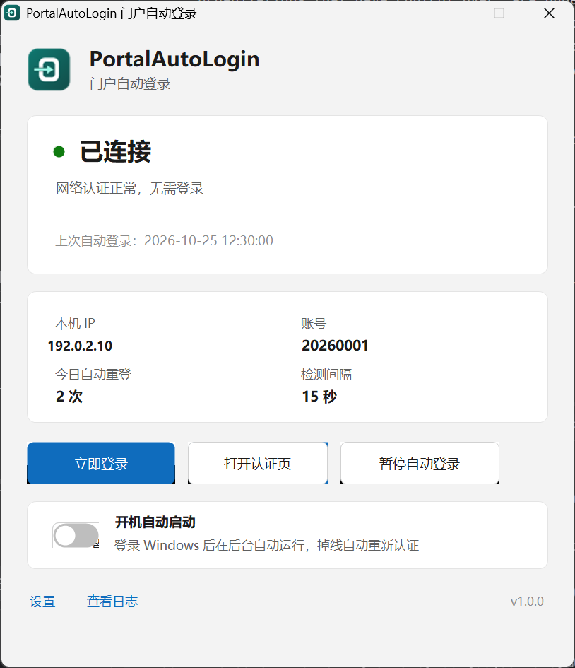
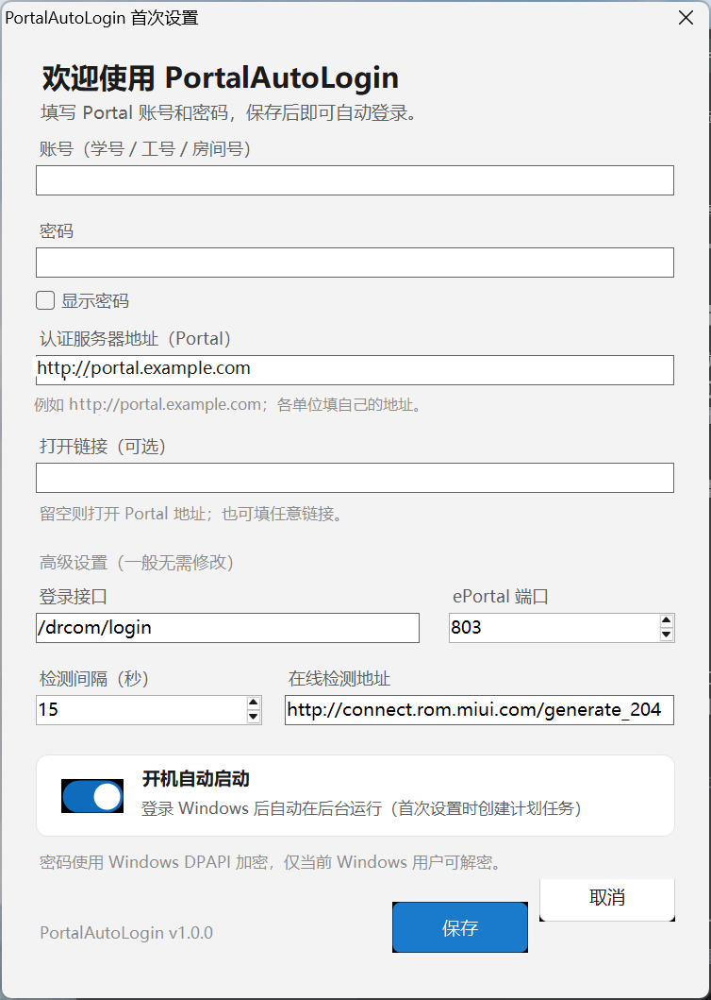

# PortalAutoLogin 门户自动登录

Windows 网页认证门户（Dr.COM / 城市热点）自动登录工具，适用于校园网、酒店、园区等需要 Portal 认证的网络。

单文件、免安装运行库、托盘常驻；开机后自动启动，掉线时自动重新登录；密码使用 Windows DPAPI 加密保存在本机。

当前版本：**v1.0.0**

作者：**sheng-fs**

<p align="center">
  
  
</p>

## 功能

- **自动登录**：检测到未认证（掉线、会话过期、开机）时，自动向 Portal 提交账号密码。
- **开机自启**：首次配置时创建“登录 Windows 后启动”的计划任务，以 `--tray` 隐藏启动；程序移动路径后会自动修复任务。
- **托盘常驻**：关闭窗口不退出；托盘图标颜色表示在线 / 重试 / 离线 / 暂停。
- **状态面板**：显示本机 IP、账号、今日自动重登次数、上次登录时间、检测间隔。
- **自定义链接**
  - `认证服务器地址`：不同学校、酒店、园区填自己的 Portal，不写死域名。
  - `打开链接（可选）`：主界面“打开认证页”打开此链接，可填自服务、公告页等任意地址；留空则打开 Portal。
  - 高级项：登录接口路径、ePortal 端口、在线检测地址，用于适配不同的 Dr.COM 部署。
- **安全存储**：密码用 DPAPI（CurrentUser）加密，只有当前 Windows 用户能解密；日志中的密码以 `***` 脱敏。
- **可诊断**：内置日志、`--test` 自检、登录失败时弹窗展示服务器原始响应。
- **高 DPI**：125% / 150% 缩放下界面自适应。

## 快速开始

1. 双击 `PortalAutoLogin.exe`（Windows 10 / 11 自带 .NET Framework 4.8，无需额外安装）。
2. 首次启动会弹出配置窗口：
   - 填写 Portal 账号和密码（学号、工号、房间号等）；
   - Portal 地址默认 `http://portal.example.com`，首次使用时改成你所在单位的地址；
   - 需要时填写“打开链接”；
   - 保持“开机自动启动”开启（默认开启）。
3. 点“保存”，程序进入托盘并开始检测。
4. 验证：打开 Portal 页面点“注销”，约 15 秒内应自动恢复为“已登录”。

> 首次验证必须用真实密码完成一次注销测试；程序内置的协议调用已做在线连通性验证，但密码正确性只能在真实掉线场景确认。

## 适配不同 Portal / 自定义链接

| 设置项 | 说明 |
| --- | --- |
| 认证服务器地址 | 认证 Portal 的根地址，如 `http://portal.example.com`。支持 `http://` 与 `https://`。 |
| 打开链接（可选） | “打开认证页”按钮的目标地址；留空使用 Portal 地址。 |
| 登录接口 | 默认 `/drcom/login`，即 Portal 的认证接口路径。 |
| ePortal 端口 | 默认 `803`，用于读取页面配置（`loadConfig`）。 |
| 在线检测地址 | 默认 `http://connect.rom.miui.com/generate_204`；若被网络拦截，可换任意返回 204 的地址。 |

## 数据与安全

| 项目 | 位置 |
| --- | --- |
| 配置（含加密后的密码） | `%LOCALAPPDATA%\PortalAutoLogin\config.json` |
| 日志 | `%LOCALAPPDATA%\PortalAutoLogin\logs\portalautologin.log` |
| 自检结果 | `%LOCALAPPDATA%\PortalAutoLogin\selftest.txt` |
| 开机自启 | 计划任务 `PortalAutoLogin`（失败时回退到启动文件夹快捷方式） |

- 密码使用 Windows DPAPI `CurrentUser` + 固定熵加密；换 Windows 用户或重装系统后无法解密，需要重新配置。
- 程序不向任何第三方上传数据；网络请求只发往你配置的 Portal 与在线检测地址。
- 日志不会记录明文密码；登录请求 URL 中的 `upass`、`user_password` 会替换为 `***`。
- 共享电脑请谨慎保存账号密码；不再使用时可按下方“卸载”清理。

## 版本与更新

版本号同时维护在两处，编译时会校验一致性：

- `VERSION`（如 `1.0.0`）
- `src/AssemblyInfo.cs` 中的 `AssemblyFileVersion`

版本号可见位置：

- 主界面右下角
- 设置页左下角
- 日志启动行：`程序启动 v1.0.0`
- `--test` 生成的 `selftest.txt`

升级步骤：

1. 托盘右键 →“退出”；
2. 用新版本 `PortalAutoLogin.exe` 覆盖旧文件（配置在 `%LOCALAPPDATA%`，不会丢失）；
3. 重新打开应用。若程序所在路径变化，开机自启任务会自动更新。

更新记录见 [CHANGELOG.md](CHANGELOG.md)。

首次纳入 Git 管理：

```bash
git add .
git commit -m "chore: PortalAutoLogin v1.0.0"
git tag -a v1.0.0 -m "PortalAutoLogin v1.0.0"
```

之后每次发布：同步修改 `VERSION` 与 `src/AssemblyInfo.cs`，更新 `CHANGELOG.md`，提交并打同名 tag。

## 卸载

1. 托盘右键 →“退出”；
2. 在“任务计划程序”中删除 `PortalAutoLogin` 任务（或在应用里关闭“开机自动启动”）；
3. 删除 `%LOCALAPPDATA%\PortalAutoLogin` 文件夹；
4. 删除 `PortalAutoLogin.exe`。

## 从源码构建

要求：

- Windows 10 / 11
- .NET Framework 4.8 Targeting Pack
- Visual Studio（提供 Roslyn `csc.exe`；脚本会自动从 vswhere 查找）

```powershell
powershell -NoProfile -ExecutionPolicy Bypass -File .\build.ps1
```

输出：项目根目录下的 `PortalAutoLogin.exe`（约 83 KB，单文件）。

图标由 `tools\draw-icon.ps1` 用代码绘制，再通过 `tools\make-ico.ps1` 生成多尺寸 ICO，不依赖外部素材：

```powershell
powershell -File .\tools\draw-icon.ps1
powershell -File .\tools\make-ico.ps1 -Png .\assets\icon-source.png -Ico .\assets\PortalAutoLogin.ico
```

## 命令行

| 参数 | 用途 |
| --- | --- |
| 无参数 | 正常启动并显示主界面 |
| `--tray` | 隐藏窗口，仅托盘运行（开机自启使用） |
| `--test` | 单次自检：检测在线状态，必要时尝试登录，结果写入 `selftest.txt` |

## 目录结构

```text
PortalAutoLogin/
├─ PortalAutoLogin.exe     # 构建产物（单文件应用）
├─ build.ps1               # 编译脚本（校验版本号、嵌入图标）
├─ VERSION                 # 版本号（语义化版本）
├─ src/                    # C# 源码
│  ├─ Program.cs           # 入口、单实例、自检
│  ├─ MainForm.cs          # 主界面与托盘
│  ├─ SettingsForm.cs      # 设置 / 首次配置
│  ├─ PortalClient.cs      # Dr.COM Portal 登录协议
│  ├─ AutoStart.cs         # 计划任务 / 启动项
│  ├─ AppConfig.cs         # 配置与 DPAPI 加密
│  ├─ Logger.cs            # 日志
│  ├─ UiTheme.cs           # 浅色 Win11 风格控件
│  └─ AssemblyInfo.cs      # 程序集信息与版本号
├─ assets/
│  ├─ PortalAutoLogin.ico  # 应用图标（多尺寸）
│  ├─ icon-source.png      # 图标原图（由脚本生成）
│  └─ screenshots/         # 界面截图
├─ tools/
│  ├─ draw-icon.ps1        # 代码绘制图标原图
│  └─ make-ico.ps1         # 由 PNG 生成多尺寸 ICO
├─ CHANGELOG.md
├─ LICENSE
├─ .gitignore
└─ .gitattributes
```

## 常见问题

**登录失败怎么办？**
界面会弹出服务器原始响应。先确认账号密码、Portal 地址正确，再把 `%LOCALAPPDATA%\PortalAutoLogin\logs\portalautologin.log` 末尾内容发给维护者。

**开机没有自动启动？**
检查“任务计划程序”中是否存在 `PortalAutoLogin` 任务；若被安全软件拦截，请手动允许。也可在应用内关闭再开启一次“开机自动启动”。

**换学校 / 换酒店 / 换 Portal？**
修改“认证服务器地址”；若对方不是 Dr.COM 系 Portal，登录接口与参数通常不同，需要适配协议，本工具不保证通用。

**密码保存在哪里？安全吗？**
`config.json` 中只有 DPAPI 密文，没有明文；只有当前 Windows 用户能解密。重装系统或换用户后需重新输入。

## 已知限制

- 仅支持 Windows。
- 仅适配 Dr.COM / 城市热点 Portal 的 Web 认证流程；门户升级后可能需要更新参数。
- 单实例、单 Windows 用户；多用户需各自配置。
- 不包含自动检查更新，需手动替换 exe。
- 不修改系统代理、DNS 或网络适配器设置。

## 名称与商标

`PortalAutoLogin` 是描述性项目名，不暗示与任何现有产品存在关联。程序图标由本项目脚本绘制，未使用第三方图标素材。

本项目为个人独立开发，与 Dr.COM、城市热点（广州热点软件科技股份有限公司、北京城市热点资讯有限公司）、任何高校、酒店、园区及网络运营商均无隶属、授权或合作关系。Dr.COM、城市热点等名称与商标归其权利人所有，此处仅用于说明兼容性，不构成任何背书。

## 免责声明

本工具仅用于自动化登录**你本人已获得授权**的网络账号，不绕过任何认证、不破解密码、不共享账号。使用前请确认符合所在学校、酒店、园区等网络管理方的规定；因使用不当造成的账号风控、网络中断或其它后果由使用者自行承担。

## 许可证

本项目采用 [PolyForm Noncommercial License 1.0.0](LICENSE)：允许个人非商业使用、修改与非商业分发，**禁止销售、付费分发及其它商业用途**。商业授权请联系作者 **sheng-fs**。
