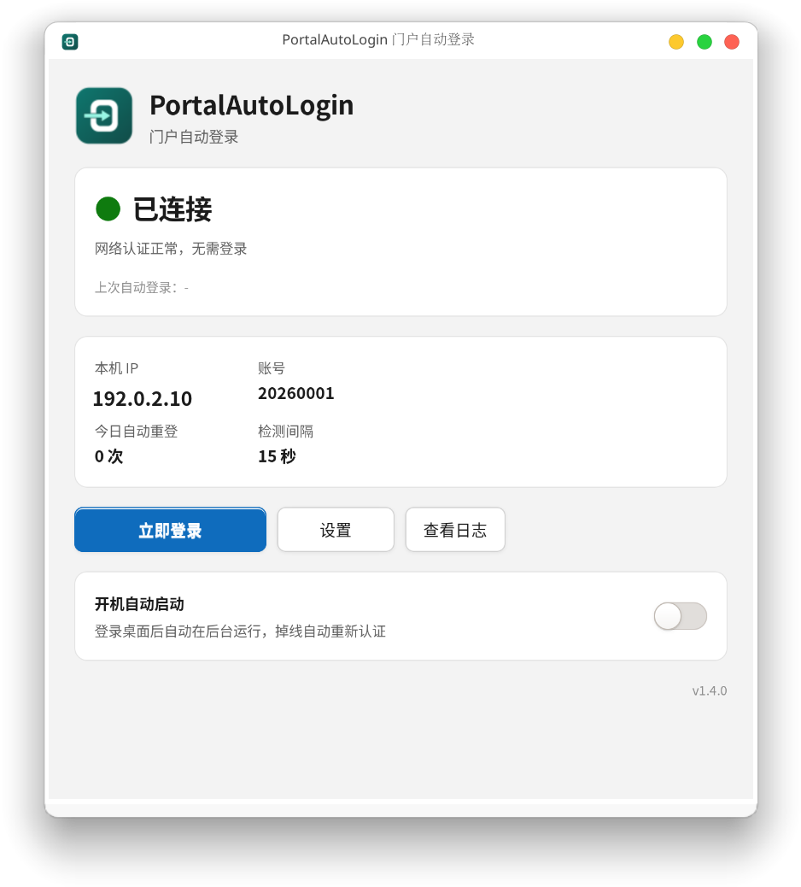
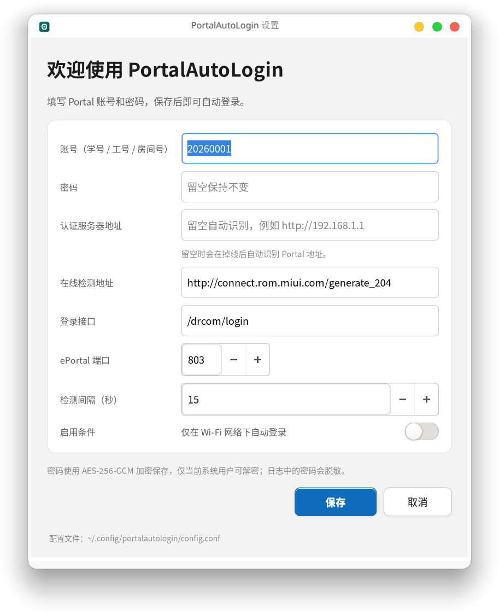

# PortalAutoLogin 门户自动登录

Windows 网页认证门户（Dr.COM / 城市热点）自动登录工具，适用于校园网、酒店、园区等需要 Portal 认证的网络。

单文件、免安装运行库、托盘常驻；开机后自动启动，掉线时自动重新登录；密码使用 Windows DPAPI 加密保存在本机。

Windows 版为托盘程序；Linux 版提供无依赖静态二进制 + systemd 服务，以及风格一致的 GTK 托盘版，见 [Linux 版本](#linux-版本)。

当前版本：**v1.4.0**

作者：**sheng-fs**

## 功能

- **自动识别认证地址**：掉线时自动从当前网络（Captive Portal 重定向 / 默认网关）发现 Portal 地址并保存，用户只需填写账号和密码，不需要手动输入链接。
- **自动登录**：检测到未认证（掉线、会话过期、开机）时，自动向 Portal 提交账号密码；登录失败会自动重新识别地址并重试一次。
- **开机自启**：写入当前用户注册表 `Run` 项，以 `--tray` 隐藏启动；每次启动按当前 exe 路径重写，程序移动目录后不会启动旧版本。
- **仅公开 Wi-Fi 启用**：当前默认路由不是 Wi-Fi 时保持待机，避免在移动网络、有线网络上误触发登录。
- **托盘常驻**：关闭窗口不退出；托盘图标颜色表示在线 / 重试 / 离线 / 暂停；后台启动时会提示托盘位置。
- **状态面板**：显示本机 IP、账号、今日自动重登次数、上次登录时间、检测间隔、已识别的认证服务器。
- **认证地址**
  - 程序自动识别并保存 Portal 地址；设置页展示识别结果，也可点“自动识别”重新获取。
  - 自动识别失败时，可在设置页手动填写认证服务器地址。
  - 高级项：登录接口路径、ePortal 端口、在线检测地址，用于适配不同的 Dr.COM 部署。
- **安全存储**：密码用 DPAPI（CurrentUser）加密，只有当前 Windows 用户能解密；日志中的密码以 `***` 脱敏。
- **可诊断**：内置日志、`--test` 自检、登录失败时弹窗展示服务器原始响应。
- **高 DPI**：125% / 150% 缩放下界面自适应。
- **低内存占用**：复用网络客户端、缓存本机 IP、减少托盘图标重绘，启动后整理工作集。
- **Linux 版**：无运行时依赖的静态二进制（x64 / arm64）+ systemd 服务；另有与 Windows 版视觉一致的 GTK 托盘版。

## 快速开始

1. 双击 `PortalAutoLogin.exe`（Windows 10 / 11 自带 .NET Framework 4.8，无需额外安装）。
2. 首次启动会弹出配置窗口：
   - 填写 Portal 账号和密码（学号、工号、房间号等）；
   - 认证服务器无需填写，程序会在需要认证的 Wi-Fi 下自动识别；识别失败时也可以手动填写；
   - 保持“开机自动启动”开启（默认开启）。
3. 点“保存”，程序进入托盘并开始检测；识别到 Portal 后会自动保存到配置中。
4. 验证：打开 Portal 页面点“注销”，约 5 秒内应自动恢复为“已登录”。

> 首次验证必须用真实密码完成一次注销测试；程序内置的协议调用已做在线连通性验证，但密码正确性只能在真实掉线场景确认。

## 适配不同 Portal / 自动识别

| 设置项 | 说明 |
| --- | --- |
| 认证服务器地址 | 默认自动识别。程序会从 Captive Portal 的 HTTP 重定向或默认网关中识别地址并保存；识别失败时可在设置页手动填写。 |
| 自动识别 | 设置页可手动触发一次识别；掉线时程序也会自动识别，登录失败会重新识别并重试。 |
| 启用条件 | 仅当当前默认路由为 Wi-Fi 时自动登录；有线网络、移动网络等保持“自动登录待机”。 |
| 登录接口 | 默认 `/drcom/login`，即 Portal 的认证接口路径。 |
| ePortal 端口 | 默认 `803`，用于读取页面配置（`loadConfig`）。 |
| 在线检测地址 | 默认 `http://connect.rom.miui.com/generate_204`；若被网络拦截，可换任意返回 204 的地址。 |

> 自动识别依赖网络把未认证用户的 HTTP 请求重定向到 Portal。若某个网络不返回重定向，程序会尝试默认网关；仍失败时请确认已连接到需要认证的网络。

## Linux 版本

Linux 版与 Windows 版共用同一套 Dr.COM / ePortal 认证流程，提供两种形态：

- **标准版**：无运行时依赖的静态二进制（x64 / arm64），命令行 + systemd 服务，适用于任何 systemd 发行版。
- **托盘版**：GTK3 + AppIndicator 图形界面（x64），主界面、设置窗口、托盘菜单和开机自启开关，视觉风格与 Windows 版一致。





### 标准版：一条命令安装

```bash
wget -O '/tmp/PortalAutoLogin-linux-x64.tar.gz' 'https://github.com/sheng-fs/PortalAutoLogin/releases/download/v1.4.0/PortalAutoLogin-linux-x64.tar.gz' \
  && sudo mkdir -p '/opt/portalautologin' \
  && sudo tar -xzf '/tmp/PortalAutoLogin-linux-x64.tar.gz' -C '/opt/portalautologin' \
  && sudo '/opt/portalautologin/install.sh' \
  && rm '/tmp/PortalAutoLogin-linux-x64.tar.gz'
```

ARM64 机器把文件名里的 `x64` 换成 `arm64`。安装脚本会：

- 把二进制放到 `/opt/portalautologin/portalautologin`；
- 链接命令到 `/usr/local/bin/portalautologin`；
- 以当前 `sudo` 用户创建并启动 `/etc/systemd/system/portalautologin.service`。

### 托盘版：一条命令安装

```bash
wget -O '/tmp/PortalAutoLogin-linux-x64-tray.tar.gz' 'https://github.com/sheng-fs/PortalAutoLogin/releases/download/v1.4.0/PortalAutoLogin-linux-x64-tray.tar.gz' \
  && sudo mkdir -p '/opt/portalautologin' \
  && sudo tar -xzf '/tmp/PortalAutoLogin-linux-x64-tray.tar.gz' -C '/opt/portalautologin' \
  && sudo '/opt/portalautologin/install-tray.sh' \
  && rm '/tmp/PortalAutoLogin-linux-x64-tray.tar.gz'
```

托盘版需要 GTK3 与 AppIndicator 运行库，安装脚本会自动检查并给出对应发行版的安装命令（Debian/Ubuntu、Fedora、Arch）。安装后：

- 命令：`portalautologin-tray`；
- 首次配置：`portalautologin-tray tray --settings`，或托盘菜单里的“设置…”；
- 开机自启：写入 `~/.config/autostart/portalautologin-tray.desktop`，也可在主界面开关；
- 托盘菜单：显示主界面、立即登录、设置、退出；关闭窗口只隐藏到托盘；
- 卸载：`sudo /opt/portalautologin/uninstall-tray.sh`。

> 托盘版与标准版二选一即可，同时安装会重复检测。托盘版使用与 Windows 版相同的图标、状态卡片、信息卡片和蓝色主按钮样式。

### 配置与使用（标准版）

```bash
portalautologin config        # 交互式填写账号密码；认证服务器可留空自动识别
portalautologin status        # 在线状态、认证服务器、上次登录、今日重登次数
portalautologin login         # 立即检测并登录一次
portalautologin test          # 自检，结果写入 ~/.config/portalautologin/selftest.txt
portalautologin logs -f       # 跟踪日志
```

非交互式配置（适合脚本）：

```bash
printf '你的密码\n' | portalautologin config --account 学号 --password-stdin
```

服务由 systemd 托管，开机自动启动、掉线自动重登：

```bash
systemctl status portalautologin
journalctl -u portalautologin -f
```

修改配置后守护进程会在下一轮检测自动加载，不需要重启服务。

### Linux 数据与安全

| 项目 | 位置 |
| --- | --- |
| 配置（含加密后的密码） | `~/.config/portalautologin/config.conf`（权限 0600） |
| 日志 | `~/.config/portalautologin/logs/portalautologin.log` |
| 自检结果 | `~/.config/portalautologin/selftest.txt` |
| systemd 服务 | `/etc/systemd/system/portalautologin.service` |
| 托盘版自启动 | `~/.config/autostart/portalautologin-tray.desktop` |

- 密码使用 AES-256-GCM 加密，密钥由 `/etc/machine-id` 与当前 UID 派生；换机器或换用户后需要重新配置。
- 日志中的 `upass`、`user_password` 统一显示为 `***`。
- 仅在检测到未认证时登录；`wifi_only=true` 时只在 Wi-Fi 网络下启用（默认 `false`，有线 Portal 也可用）。
- 卸载：标准版 `sudo /opt/portalautologin/uninstall.sh`，托盘版 `sudo /opt/portalautologin/uninstall-tray.sh`；均不会删除用户配置。

### 从源码构建 Linux 版

需要 Go 1.22 或更高版本；托盘版还需要 GTK3 与 AppIndicator 开发库（Debian/Ubuntu：`libgtk-3-dev libayatana-appindicator3-dev`）：

```bash
./linux/build.sh
```

输出：

- `dist/PortalAutoLogin-linux-x64.tar.gz`
- `dist/PortalAutoLogin-linux-arm64.tar.gz`
- `dist/PortalAutoLogin-linux-x64-tray.tar.gz`（缺少 GTK 开发库时自动跳过）

## 鸿蒙版本

工作区目录下的 `PortalAutoLogin-HarmonyOS` 是独立的 HarmonyOS（ArkTS / Stage 模型）工程，使用相同名称与图标。用 DevEco Studio 打开并配置自动签名即可运行；支持自动识别、自动登录、后台连续任务（通知栏可见）、仅 Wi-Fi 启用，以及手动填写认证服务器。界面使用响应式栅格，已适配手机、折叠屏、平板与 PC（2in1）窗口。

## 数据与安全

| 项目 | 位置 |
| --- | --- |
| 配置（含加密后的密码） | `%LOCALAPPDATA%\PortalAutoLogin\config.json` |
| 日志 | `%LOCALAPPDATA%\PortalAutoLogin\logs\portalautologin.log` |
| 自检结果 | `%LOCALAPPDATA%\PortalAutoLogin\selftest.txt` |
| 开机自启 | 注册表 `HKCU\Software\Microsoft\Windows\CurrentVersion\Run\PortalAutoLogin`（失败时回退到启动文件夹快捷方式） |

- 密码使用 Windows DPAPI `CurrentUser` + 固定熵加密；换 Windows 用户或重装系统后无法解密，需要重新配置。
- 程序不向任何第三方上传数据；网络请求只发往自动识别的 Portal 与在线检测地址。
- 日志不会记录明文密码；登录请求 URL 中的 `upass`、`user_password` 会替换为 `***`。
- 共享电脑请谨慎保存账号密码；不再使用时可按下方“卸载”清理。

## 版本与更新

版本号同时维护在两处，编译时会校验一致性：

- `VERSION`（如 `1.2.1`）
- `src/AssemblyInfo.cs` 中的 `AssemblyFileVersion`

版本号可见位置：

- 主界面右下角
- 设置页左下角
- 日志启动行：`程序启动 v1.4.0`
- `--test` 生成的 `selftest.txt`

升级步骤：

1. 托盘右键 →“退出”；
2. 用新版本 `PortalAutoLogin.exe` 覆盖旧文件（配置在 `%LOCALAPPDATA%`，不会丢失）；
3. 重新打开应用。程序会自动按当前路径重写开机自启项，并清理旧版计划任务。

更新记录见 [CHANGELOG.md](CHANGELOG.md)。

首次纳入 Git 管理：

```bash
git add .
git commit -m "chore: PortalAutoLogin v1.2.1"
git tag -a v1.2.1 -m "PortalAutoLogin v1.2.1"
```

之后每次发布：同步修改 `VERSION` 与 `src/AssemblyInfo.cs`，更新 `CHANGELOG.md`，提交并打同名 tag。

## 卸载

1. 托盘右键 →“退出”；
2. 在应用里关闭“开机自动启动”，或删除注册表 `HKCU\Software\Microsoft\Windows\CurrentVersion\Run\PortalAutoLogin`；
3. 删除 `%LOCALAPPDATA%\PortalAutoLogin` 文件夹；
4. 删除 `PortalAutoLogin.exe`。

Linux 版卸载：

```bash
sudo /opt/portalautologin/uninstall.sh
```

## 从源码构建（Windows）

要求：

- Windows 10 / 11
- .NET Framework 4.8 Targeting Pack
- Visual Studio（提供 Roslyn `csc.exe`；脚本会自动从 vswhere 查找）

```powershell
powershell -NoProfile -ExecutionPolicy Bypass -File .\build.ps1
```

输出：项目根目录下的 `PortalAutoLogin.exe`（约 90 KB，单文件）。

图标由 `tools\draw-icon.ps1` 用代码绘制，再通过 `tools\make-ico.ps1` 生成多尺寸 ICO，不依赖外部素材：

```powershell
powershell -File .\tools\draw-icon.ps1
powershell -File .\tools\make-ico.ps1 -Png .\assets\icon-source.png -Ico .\assets\PortalAutoLogin.ico
```

## 命令行（Windows）

| 参数 | 用途 |
| --- | --- |
| 无参数 | 正常启动并显示主界面 |
| `--tray` | 隐藏窗口，仅托盘运行（开机自启使用） |
| `--test` | 单次自检：检测在线状态，必要时尝试登录，结果写入 `selftest.txt` |

## 目录结构

```text
PortalAutoLogin/
├─ PortalAutoLogin.exe     # 构建产物（单文件应用）
├─ build.ps1               # 编译脚本（校验版本号、嵌入图标）
├─ VERSION                 # 版本号（语义化版本）
├─ src/                    # C# 源码
│  ├─ Program.cs           # 入口、单实例、自检
│  ├─ MainForm.cs          # 主界面与托盘
│  ├─ SettingsForm.cs      # 设置 / 首次配置
│  ├─ PortalClient.cs      # Dr.COM Portal 登录协议
│  ├─ PortalDetector.cs    # Captive Portal / 网关自动识别
│  ├─ NetworkGuard.cs      # 判断当前默认路由是否为 Wi-Fi
│  ├─ AutoStart.cs         # 注册表 Run 项 / 启动项
│  ├─ AppConfig.cs         # 配置与 DPAPI 加密
│  ├─ Logger.cs            # 日志
│  ├─ MemoryTrim.cs        # 启动后整理工作集
│  ├─ UiTheme.cs           # 浅色 Win11 风格控件
│  └─ AssemblyInfo.cs      # 程序集信息与版本号
├─ assets/
│  ├─ PortalAutoLogin.ico  # 应用图标（多尺寸）
│  ├─ icon-source.png      # 图标原图（由脚本生成）
│  └─ screenshots/         # 界面截图
├─ tools/
│  ├─ draw-icon.ps1        # 代码绘制图标原图
│  └─ make-ico.ps1         # 由 PNG 生成多尺寸 ICO
├─ linux/                  # Linux 版（Go）
│  ├─ main.go              # 命令入口：status / login / config / daemon / tray / test / logs
│  ├─ portal.go            # Dr.COM Portal 登录协议
│  ├─ detect.go            # Captive Portal 自动识别
│  ├─ netguard.go          # 默认路由与 Wi-Fi 判断
│  ├─ config.go            # 配置、AES-GCM 密码加密、状态统计
│  ├─ gui_tray.go          # GTK 托盘版主界面 / 设置界面 / 自动重登
│  ├─ indicator_tray.go    # AppIndicator 托盘图标封装
│  ├─ gui_stub.go          # 标准版中的 tray 命令占位
│  ├─ http.go / log.go / daemon.go
│  ├─ install.sh           # 标准版安装脚本（写入 systemd 服务）
│  ├─ uninstall.sh
│  ├─ portalautologin.service
│  ├─ install-tray.sh      # 托盘版安装脚本（图标、自启动、应用菜单）
│  ├─ uninstall-tray.sh
│  ├─ portalautologin.png  # Linux 图标（由 Windows 图标生成）
│  └─ build.sh             # 生成 dist/*.tar.gz
├─ dist/                   # Linux 打包产物（不入库）
├─ CHANGELOG.md
├─ LICENSE
├─ .gitignore
└─ .gitattributes
```

## 常见问题

**登录失败怎么办？**
界面会弹出服务器原始响应。先确认账号密码、Portal 地址正确，再把 `%LOCALAPPDATA%\PortalAutoLogin\logs\portalautologin.log` 末尾内容发给维护者。Linux 版对应日志为 `~/.config/portalautologin/logs/portalautologin.log`，也可执行 `portalautologin test` 或 `portalautologin logs -n 100` 查看。

**开机没有自动启动？**
检查注册表 `HKCU\Software\Microsoft\Windows\CurrentVersion\Run` 中是否有 `PortalAutoLogin`，或任务管理器“启动”页是否被禁用；若被安全软件拦截，请手动允许。也可在应用内关闭再开启一次“开机自动启动”。Windows 11 的托盘图标可能被收纳到任务栏 `^` 溢出区，可拖动到任务栏固定显示。

**换学校 / 换酒店 / 换 Portal？**
程序会自动重新识别认证服务器；若对方不是 Dr.COM 系 Portal，登录接口与参数通常不同，需要适配协议，本工具不保证通用。

**密码保存在哪里？安全吗？**
Windows 版 `config.json` 中只有 DPAPI 密文，没有明文；只有当前 Windows 用户能解密。Linux 版 `config.conf` 中的密码使用 AES-256-GCM 加密，文件权限 0600。重装系统或换用户后需重新输入。

## 已知限制

- Windows 版仅支持 Windows；Linux 版提供静态 CLI + systemd 与 GTK 托盘两种包；鸿蒙版本为工作区内同级目录的独立工程 `PortalAutoLogin-HarmonyOS`。
- 自动识别依赖网络返回 Captive Portal 重定向或可用的默认网关；极少数仅支持 HTTPS 登录页的网络可能无法识别。
- 仅适配 Dr.COM / 城市热点 Portal 的 Web 认证流程；门户升级后可能需要更新参数。
- Windows 版单实例、单 Windows 用户；Linux 版每个系统用户各自配置；多用户需各自配置。
- 不包含自动检查更新，需手动替换 exe 或重新执行安装命令。
- 不修改系统代理、DNS 或网络适配器设置。

## 名称与商标

`PortalAutoLogin` 是描述性项目名，不暗示与任何现有产品存在关联。程序图标由本项目脚本绘制，未使用第三方图标素材。

本项目为个人独立开发，与 Dr.COM、城市热点（广州热点软件科技股份有限公司、北京城市热点资讯有限公司）、任何高校、酒店、园区及网络运营商均无隶属、授权或合作关系。Dr.COM、城市热点等名称与商标归其权利人所有，此处仅用于说明兼容性，不构成任何背书。

## 免责声明

本工具仅用于自动化登录**你本人已获得授权**的网络账号，不绕过任何认证、不破解密码、不共享账号。使用前请确认符合所在学校、酒店、园区等网络管理方的规定；因使用不当造成的账号风控、网络中断或其它后果由使用者自行承担。

## 许可证

本项目采用 [PolyForm Noncommercial License 1.0.0](LICENSE)：允许个人非商业使用、修改与非商业分发，**禁止销售、付费分发及其它商业用途**。商业授权请联系作者 **sheng-fs**。
